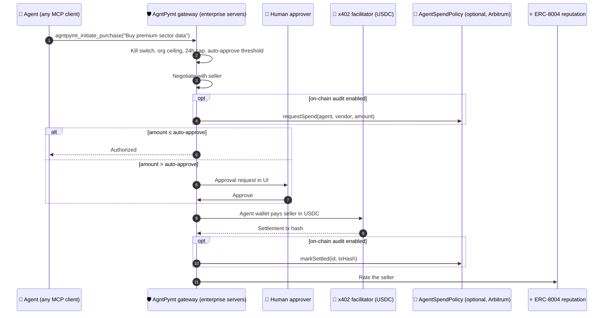

<div align="center">


<a href="https://github.com/SumitShinde0702/agntpymt-arbitrum">
  
</a>

<p>
  <a href="https://sepolia.arbiscan.io/address/0x542A4322762b255f8bA53F6A236B6191c8Cd0e1c"></a>
  <a href="https://explorer.testnet.chain.robinhood.com/address/0x7F67212561DcD231a9316a54A4A336F7059A4234#code"></a>
  <a href="https://repo.sourcify.dev/421614/0x542A4322762b255f8bA53F6A236B6191c8Cd0e1c"></a>
</p>

<p>
  
  
  
  
  
  
  
  
  
  
</p>

<p>
  <a href="#-the-problem">Problem</a> ·
  <a href="#-the-solution">Solution</a> ·
  <a href="#-how-it-works">How it works</a> ·
  <a href="#-plug-in-any-agent-over-mcp">MCP</a> ·
  <a href="#-deployed-contracts">Contracts</a> ·
  <a href="#-quick-start">Quick start</a> ·
  <a href="#-demo-flows">Demo</a>
</p>

</div>

---

## 🚨 The problem

AI agents can now buy API calls, data and SaaS, and pay invoices on their own. Telling an AI *"don't spend more than $10"* is a suggestion, not a control: models hallucinate, get prompt-injected, and misread instructions. When an agent holds a funded wallet, one bad output becomes a real payment you can't undo.

No bank, fintech or supply chain will hand an LLM a funded wallet without the controls it applies to employees: **spending limits, approvals, a kill switch and an audit trail**. So today enterprises either block agent payments entirely, or hard-code a private key and hope for the best.

> Most agent-payment work targets consumers: one agent buying for one person. **AgntPymt is built for the enterprise:** fleets of agents spending company money, under rules a regulator can audit.

## 🛡️ The solution

AgntPymt is a **self-hosted payment gateway that sits between an enterprise's AI agents and its money**. The agent decides what it wants to buy. AgntPymt decides whether it's allowed, then settles in stablecoins over [x402](https://x402.org).

It runs on the enterprise's own servers. Policy checks happen in the gateway at API speed, agent keys never leave the company's infrastructure, and AgntPymt the company never holds or moves customer funds.

<table>
  <tr>
    <td width="50%" valign="top">
      <h3>🪪 Agent identity</h3>
      Every agent gets its own wallet and an <b>ERC-8004</b> identity. Every dollar is tied to a named agent, not a shared key.
    </td>
    <td width="50%" valign="top">
      <h3>📜 Rules in code, not in prompts</h3>
      The gateway enforces auto-approve thresholds, rolling 24-hour caps, an org-wide exposure ceiling and a kill switch <b>before any payment is signed</b>. The LLM never holds the key, so no prompt can talk its way past a limit.
    </td>
  </tr>
  <tr>
    <td width="50%" valign="top">
      <h3>🙋 Human-in-the-loop</h3>
      Small spends settle instantly. Anything above the threshold waits in the approvals queue for a human, at machine speed rather than ticket speed.
    </td>
    <td width="50%" valign="top">
      <h3>🧾 Regulator-grade audit</h3>
      Every decision (authorize, escalate, approve, deny, settle) is logged with the x402 settlement hash. Enterprises that want a tamper-proof public record can anchor it on Arbitrum with <code>AgentSpendPolicy</code>.
    </td>
  </tr>
</table>

### 🏢 Why self-hosted and non-custodial

- **Your servers, your keys, your rules.** Banks and fintechs won't route agent spend through a third party's cloud. AgntPymt deploys into their own environment (Docker image included).
- **We never touch the money.** The enterprise's agents pay vendors directly in stablecoins. AgntPymt is software, not a payment intermediary.
- **Fast by default.** Policy runs in-process at the gateway, so a $0.01 API call isn't held up waiting for a block. On-chain anchoring is opt-in.

### ⛓️ Where the chain comes in

- **Settlement:** USDC over x402 on Arbitrum (`eip155:421614`). The gateway is rail-agnostic; more EVM chains and XRPL are on the roadmap.
- **Identity and reputation:** agents and sellers are registered on the **ERC-8004** registries, and every seller is rated after settlement.
- **Optional audit anchor:** `AgentSpendPolicy` mirrors the gateway's decisions on-chain (request, approve, settle, cancel) so an auditor can verify the trail on Arbiscan without trusting the enterprise's database. It's deployed and verified on Arbitrum Sepolia and Robinhood Chain testnet.

## 🔄 How it works



## 🔌 Plug in any agent over MCP

AgntPymt ships an MCP server, so any agent that speaks MCP (Claude, Cursor, Hermes, LangChain and others) can pay through the gateway without an SDK integration:

| Tool | What it does |
| --- | --- |
| `agntpymt_get_agent_policy` | The agent's identity, wallet and spend limits |
| `agntpymt_initiate_purchase` | Match a vendor, enforce policy, negotiate and settle |
| `agntpymt_request_paid_resource` | Buy premium data or compute through the gateway |
| `agntpymt_list_pending_approvals` | Purchases waiting on a human |
| `agntpymt_list_transactions` | The agent's audit ledger |
| `agntpymt_list_agents` | Agents in the org |

The goal is one-prompt onboarding: a company pastes a setup prompt into its existing agent, the agent connects to AgntPymt, and a human sets its limits in the dashboard. Limits are always set by a human; the agent can only read them.

### 📜 `AgentSpendPolicy.sol`: optional on-chain audit anchor ([`contracts/`](contracts/))

For enterprises that want their auditor to verify the trail independently, the gateway mirrors each decision to this contract. The contract re-checks the same limits, so a buggy or compromised gateway can't record a spend that breaks policy without the contract rejecting it.

| Feature | How |
| --- | --- |
| 🪪 **Agent binding** | Org admin binds an agent wallet with an **EIP-712 consent signature from the agent**, so nobody can claim someone else's agent address |
| 📏 **Limits** | Per-tx cap, rolling-day cap, auto-approve threshold (invariant: `auto ≤ perTx ≤ daily`) |
| 🙋 **Human-in-the-loop** | Spends above the threshold are `PendingApproval` until the admin calls `approve()`; they expire after 3 days |
| 🛑 **Kill switches** | Per-agent `setAgentActive(false)` and org-wide `setOrgFrozen(true)`; both also block settlement of already-authorized spends |
| 🔑 **Operators** | Admin can delegate request/settle to a backend (AgntPymt), so agents need no gas |
| 💸 **Settlement** | `markSettled(id, x402TxHash)` for off-contract x402 payments, or `execute(id)` to pull USDC agent → vendor via `transferFrom` |
| 🔒 **Safety** | OpenZeppelin `SafeERC20`, `ReentrancyGuard`, `SignatureChecker` (EOA + ERC-1271), custom errors, checks-effects-interactions |

## 🌐 Deployed contracts

| Network | AgentSpendPolicy | Token | Source verified |
| --- | --- | --- | --- |
| **Arbitrum Sepolia** (421614) | [`0x542A4322762b255f8bA53F6A236B6191c8Cd0e1c`](https://sepolia.arbiscan.io/address/0x542A4322762b255f8bA53F6A236B6191c8Cd0e1c) | USDC `0x75faf114eafb1BDbe2F0316DF893fd58CE46AA4d` | ✅ [Sourcify exact match](https://repo.sourcify.dev/421614/0x542A4322762b255f8bA53F6A236B6191c8Cd0e1c) |
| **Robinhood Chain testnet** (46630) | [`0x7F67212561DcD231a9316a54A4A336F7059A4234`](https://explorer.testnet.chain.robinhood.com/address/0x7F67212561DcD231a9316a54A4A336F7059A4234#code) | MockUSDC [`0x542A…0e1c`](https://explorer.testnet.chain.robinhood.com/address/0x542A4322762b255f8bA53F6A236B6191c8Cd0e1c#code) | ✅ Blockscout |

ERC-8004 registries (Arbitrum Sepolia): Identity `0x8004A818BFB912233c491871b3d84c89A494BD9e`, Reputation `0x8004B663056A597Dffe9eCcC1965A193B7388713`.

Deployment records: [`contracts/deployments/`](contracts/deployments/).

<details>
<summary><b>🧪 Contracts: test and deploy</b></summary>

```bash
cd contracts
npm install
npm test                          # 16 tests: binding, limits, approvals, kill switches, settlement
npm run deploy:arbitrum-sepolia   # needs DEPLOYER_PRIVATE_KEY with Arbitrum Sepolia ETH
npm run deploy:robinhood-testnet
npm run export-abi                # refresh server/src/chain/spend-policy-abi.ts
```

Server integration smoke test against any RPC (local Hardhat node or Arbitrum Sepolia):

```bash
SPEND_POLICY_ADDRESS=0x... SPEND_POLICY_ADMIN_PRIVATE_KEY=0x... npx tsx server/scripts/smoke-spend-policy.ts
```

</details>

## 🚀 Quick start

```bash
# 1. Copy env (single root .env for client + server)
cp .env.example .env

# 2. Install dependencies
npm install

# 3. Start PostgreSQL (Docker)
npm run db:up

# 4. Build db package, migrate & seed
npm run build -w db
npm run db:migrate
npm run db:seed

# 5. Start dev (client :5173 + server :3001)
npm run dev
```

Open [http://localhost:5173](http://localhost:5173). The landing page is at [`/home`](http://localhost:5173/home).

All variables live in **one root `.env`** file. Vite reads `VITE_*` keys via `envDir: '..'` in `client/vite.config.ts`, and the server loads the same file from the repo root.

## 🎬 Demo flows

Micro-payments default to **$0.01 USDC** (`DEMO_TRANSACTION_FEE_USD` in `.env`). Re-seed after pricing changes: `npm run db:seed`.

| # | Flow | Agent | What happens |
| --- | --- | --- | --- |
| 1 | ✅ **Auto-approve + negotiate** | Research Agent | "Buy premium sector research data": seller quotes $0.02, agent counters $0.01, settles instantly |
| 2 | ⚡ **Instant micro-pay** | Procurement Agent | "Order office supplies": $0.01, under the limit, no approval needed |
| 3 | 🙋 **Human approval** | Cloud Ops Agent | "Pay AWS invoice": negotiates to $0.08, exceeds the $0.05 auto-approve limit, approve in UI |

<details>
<summary><b>🤖 Optional: Hermes background runtime</b></summary>

AgntPymt provisions one **Hermes profile per agent** under `~/.hermes/profiles/{orgId}__{agentId}/` with `SOUL.md`, `config.yaml` (including the `agntpymt` MCP server), and `skills/`. Manage identity and capabilities from **Agents → Identity / Capabilities** in the UI.

### Local setup

```bash
pip install hermes-agent
hermes setup
# Enable API in ~/.hermes/.env:
#   API_SERVER_ENABLED=true
npm run dev:all   # client + server + hermes gateway (:8642)
```

On Windows, Hermes 0.17.0 can crash with `ModuleNotFoundError: cron.scheduler_provider` (package name collision). `dev:all` uses `scripts/hermes-gateway.py` to work around this automatically.

If the gateway starts but AgntPymt still shows Hermes offline, confirm `API_SERVER_ENABLED=true` in `~/.hermes/.env` and restart `npm run dev:all`.

When the Hermes gateway is online, **Run** in the Agent Console delegates to Hermes with the agent's SOUL as `instructions` and streams lifecycle events into the chat feed. Purchases go through the `agntpymt` MCP tool (`AGENT_ID` is set per profile in `config.yaml`).

### Single-gateway limitation

One `hermes gateway` process uses **one** `HERMES_HOME` at startup. All agent profile **files** are created on disk, but skills/MCP from inactive profiles are not loaded until that profile is the gateway's home. For local MVP:

- SOUL is passed via `instructions` on each `/v1/runs` call (works across profiles).
- The shared `agntpymt` MCP entry uses per-profile `AGENT_ID` in env when Hermes loads that profile's `config.yaml`.

For full per-agent runtime isolation later: one gateway per org, subprocess per run with `HERMES_HOME=profile_path`, or Hermes per-run profile APIs.

See `docs/hermes-mcp.example.json` for a manual MCP reference (AgntPymt auto-writes this into each agent profile).

</details>

## 🗺️ Roadmap

- [x] Self-hosted gateway with auto-approve, 24h caps, org ceiling, kill switch and human approvals
- [x] MCP server so any MCP-capable agent can pay through the gateway
- [x] x402 USDC settlement and ERC-8004 identity and reputation on Arbitrum
- [x] Optional on-chain audit anchor (`AgentSpendPolicy`, 16 Hardhat tests), verified on Arbitrum Sepolia and Robinhood Chain testnet
- [ ] One-prompt onboarding: paste a prompt into your agent and it connects itself to AgntPymt
- [ ] Vendor allowlists, tool allowlists, and payment-count limits per day, week and month
- [ ] Invoice capture, entered by a human or generated by the agent
- [ ] Enterprise key management (cloud KMS, HSM or MPC) in place of keys in environment files
- [ ] More stablecoin rails: additional EVM chains and XRPL
- [ ] Merchant side: let sellers accept governed agent payments

---

<div align="center">

**Your agents are moving fast. Your controls should too.**

Started at the Arbitrum Open House Singapore Buildathon. Submitted to Colosseum's Crypto World's Fair.

</div>
